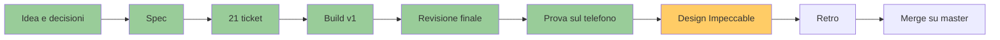

# Roadmap

Aggiornata il **2026-11-21**. Fase attuale: **design con Impeccable**: Outfit, Guardaroba e Preferiti sistemate; prossima Impostazioni.

Riferimenti: [[spec]] · [[GLOSSARY]] · [[PRODUCT]] · storico completo: `git log --oneline` (116 commit, branch `guardaroba-v1`, non ancora su `master`).

## Fasi

- [x] **Idea e decisioni**: grilling, ADR [[0001-offline-regole-senza-ai]] → [[0005-min-sdk-26]]
- [x] **Spec**: [[spec]], 67 storie utente
- [x] **Ticket**: 21 ticket tracer-bullet in `.scratch/guardaroba-v1/issues/`
- [x] **Build v1**: tutti i 21 ticket chiusi (vedi sotto)
- [x] **Revisione finale** dell'intero branch: correzioni sulle foto, sulla sessione Outfit e sugli ADR
- [x] **Decisioni dopo la revisione**: Preferito "Non più valido" ([[0011-preferito-giudicato-con-i-capi-di-adesso]]), popup capo fuori stagione ([[0008-parti-da-capo-ignora-filtro]])
- [x] **Prova sul telefono** (Pixel 8 Pro) con `scripts/installa-sul-telefono.sh`, compreso il backup `bmgr`
- [ ] **Design con Impeccable**: una schermata alla volta, critica → modifiche → prova sul telefono
  - [x] [[PRODUCT]] scritto (`/impeccable init`)
  - [x] Outfit: critica 24/40 → 5 modifiche fatte ([[0012-schermata-outfit-ridisegnata]]); da ricriticare per il nuovo punteggio
  - [x] Guardaroba e scheda Capo: critica 22/40 → 5 modifiche fatte ([[0013-guardaroba-e-scheda-capo-ridisegnati]]): pulsante Filtri, scheda corta con barra ✕/Salva, conferma "Scartare le modifiche?", "Salva e aggiungi un altro", "Duplica", riga "Manca: …"; da ricriticare
  - [x] Preferiti: critica 23/40 → 5 modifiche fatte ([[0014-preferiti-ridisegnati]]): apertura in grande, "Non più valido" con rimedio, contrasto sul giallo, Spiegazione in frase, snackbar con Annulla; provati sul telefono; da ricriticare
  - [ ] Impostazioni
- [ ] **Retro**: problemi ricorrenti → regole nel CLAUDE.md
- [ ] **Merge su `master`** e push: solo su tua richiesta

## Build v1: ticket chiusi

| Area | Ticket |
|---|---|
| Base | [[01-scheletro-app]] |
| Guardaroba | [[02-aggiungere-capo]] · [[03-campi-completi-capo]] · [[04-modificare-capo]] · [[05-foto-capo]] · [[06-filtri-guardaroba]] · [[17-eliminare-capo]] |
| Motore Outfit | [[07-genera-prima-proposta]] · [[08-armonie-due-colori]] · [[09-limite-fantasia]] · [[10-intero]] · [[11-filtro-stagione-capospalla]] · [[12-nessuna-ripetizione]] · [[13-parti-da-capo]] · [[14-colori-consigliati]] |
| Preferiti | [[15-salvare-preferiti]] · [[16-nome-elimina-preferiti]] |
| Dati | [[18-backup-automatico]] · [[19-esporta-zip]] · [[20-importa-zip]] |
| Verifica | [[21-rifinitura-verifica-telefono]] |

## Decisioni (ADR)

[[0001-offline-regole-senza-ai]] · [[0002-android-nativo]] · [[0003-foto-compresse-e-backup]] · [[0004-regole-di-armonia]] · [[0005-min-sdk-26]] · [[0006-filtro-stagione-azzera-gia-viste]] · [[0007-formato-export-zip]] · [[0008-parti-da-capo-ignora-filtro]] · [[0009-import-sostituisce-con-foto-rinominate]] · [[0010-proposta-scade-se-cambiano-i-suoi-capi]] · [[0011-preferito-giudicato-con-i-capi-di-adesso]] · [[0012-schermata-outfit-ridisegnata]] · [[0013-guardaroba-e-scheda-capo-ridisegnati]] · [[0014-preferiti-ridisegnati]]

## Punteggi di design (Impeccable)

| Schermata | Critica | Dopo le modifiche |
|---|---|---|
| Outfit | 24/40 | da ricriticare |
| Guardaroba e scheda Capo | 22/40 | da ricriticare |
| Preferiti | 23/40 | da ricriticare |
| Impostazioni | — | — |

Le critiche complete sono in `.impeccable/critique/`.

## Solo tu

- [ ] Rinominare `Π PROJECTS` senza caratteri speciali, se vuoi eliminare il disco `X:` (vedi README → Build)
- [ ] `npx impeccable login`, opzionale, per lo storico delle critiche nel tuo account
- [ ] Installare sul telefono dopo ogni fase di design: `& "C:\Program Files\Git\bin\bash.exe" scripts/installa-sul-telefono.sh`

## Pianificato dopo la v1

Funzioni decise come **planned**, fuori dalla v1 (vedi [[0001-offline-regole-senza-ai]]). La v1 non contiene codice preparatorio per queste voci.

- [ ] Armocromia personale: stagione cromatica, sottotono, colori che "ti donano"
- [ ] Contesto dell'outfit: meteo, occasione (lavoro/sera/sport), calendario
- [ ] Più utenti / profili
- [ ] Suggerimenti di acquisto ("ti manca un pantalone beige")
- [ ] Stato del Capo (in lavatrice, prestato)
- [ ] Storico "cosa ho indossato quando" e contatore di utilizzi
- [ ] Condivisione degli Outfit
- [ ] Widget, notifiche, outfit del giorno
